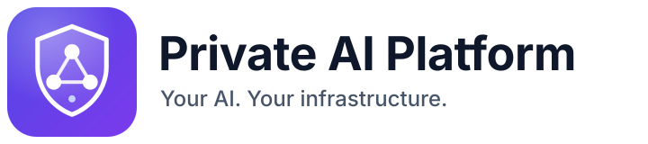
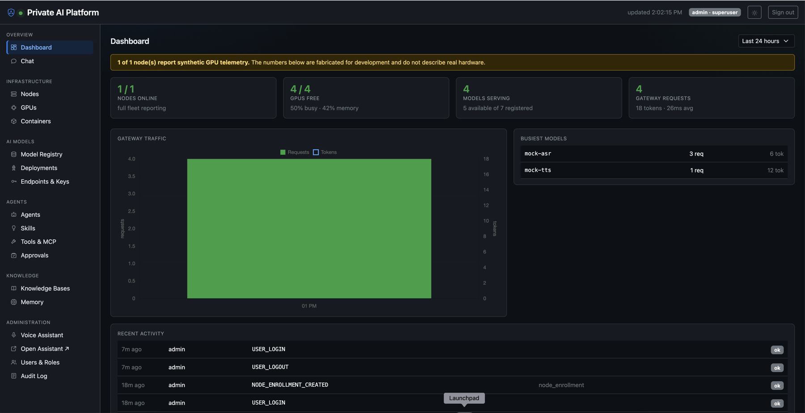
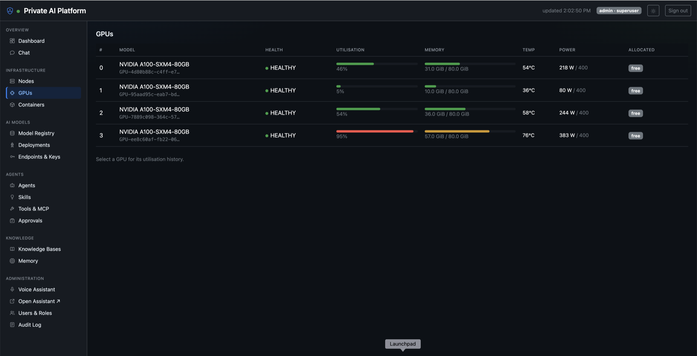
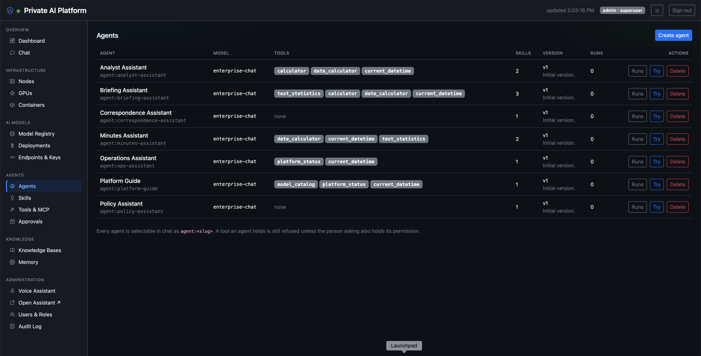
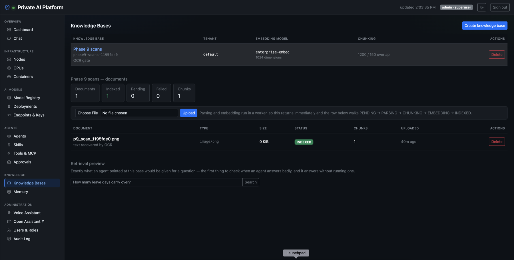
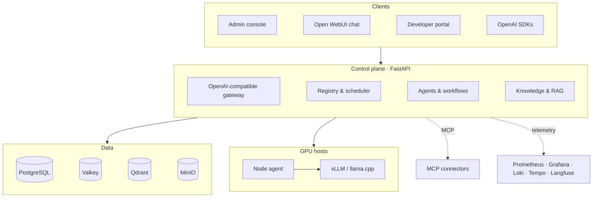

<p align="center">
  <picture>
    <source media="(prefers-color-scheme: dark)" srcset="docs/images/logo-wordmark-dark.svg">
    
  </picture>
</p>

<h3 align="center">Your AI. Your infrastructure. No route to the Internet.</h3>

<p align="center">
  A self-hosted platform to run your own models on your own GPUs, and give your organisation an
  OpenAI-compatible API, agents, workflows, document search, chat and voice:
  governed, audited and observable from one console.
</p>

<p align="center">
  <a href="https://github.com/mkamranr/private-ai-platform/actions/workflows/ci.yml"></a>
  <a href="docker-compose.yml"></a>
  <a href="backend/pyproject.toml"></a>
  <a href="backend/requirements.in"></a>
  <a href="docs/api.md"></a>
  <a href="docs/airgap.md"></a>
  <a href="LICENSE"></a>
</p>

<p align="center">
  <a href="#highlights"><b>Highlights</b></a> ·
  <a href="#features"><b>Features</b></a> ·
  <a href="#architecture"><b>Architecture</b></a> ·
  <a href="#quick-start"><b>Quick start</b></a> ·
  <a href="#deploying"><b>Deploying</b></a> ·
  <a href="#air-gapped-install"><b>Air-gapped install</b></a> ·
  <a href="#documentation"><b>Docs</b></a>
</p>

<p align="center">
  
</p>

---

## Highlights

<table>
<tr>
<td width="33%" valign="top">

### Fully offline
Installs and upgrades from a **signed bundle**, with an offline root key. No runtime
downloads, no telemetry, no cloud dependency.

</td>
<td width="33%" valign="top">

### OpenAI drop-in
Point any OpenAI SDK at `/v1` with a platform key. Chat, embeddings, speech and streaming
work **with no code changes**.

</td>
<td width="33%" valign="top">

### Governed by default
Roles, teams, quotas, model approval and **human approval** for risky actions. Every
change and every refusal is audited.

</td>
</tr>
<tr>
<td width="33%" valign="top">

### GPU-aware
Live telemetry per card, GPU-aware placement, **zero-downtime revisions** and rollouts,
load balancing with failover across copies.

</td>
<td width="33%" valign="top">

### Agents and workflows
Versioned agents with tools, skills and MCP connectors, and a **visual workflow canvas**
with branches, loops and sub-workflows.

</td>
<td width="33%" valign="top">

### Runs anywhere
Real GPUs with vLLM, CPU with llama.cpp, Ollama, or a **mock runtime**, so a laptop
runs the whole platform and its tests.

</td>
</tr>
</table>

---

## Features

### Models and GPUs

| | |
|---|---|
| **GPU fleet** | Enrol GPU hosts with a one-time token. Live utilisation, memory, temperature and power per card, with alerts that don't flap, and alert levels per node or per card. |
| **Model registry** | Import or register models and deploy them with GPU-aware placement, after a dry run. Revisions roll back, logs stream live. |
| **Runtimes** | vLLM, llama.cpp, Ollama, hosted OpenAI-compatible providers, or a mock runtime. What a model can do (tools, vision, streaming) is read from the runtime itself whenever a copy starts. |
| **Inference backends** | Attach existing vLLM, Ollama or OpenAI-compatible servers, watch their health and load over time with alerts on queues and KV cache, catalogue their models in one click, and load or unload Ollama models from the console. |
| **Zero-downtime changes** | A revision starts a new copy and switches over once it is healthy; a rollout revises every copy of a model one at a time, optionally watching one or more **canary** copies on a share of real traffic first, stopping on errors or slower latency. Each copy's share of traffic can be set by hand. |
| **Model governance** | Approved, experimental, deprecated or blocked, with licence and source metadata. A blocked model is never served. |

### OpenAI-compatible gateway

| | |
|---|---|
| **One API** | Chat, completions, embeddings, speech-to-text and text-to-speech at `/v1`, with streaming. |
| **Resilient** | Aliases with fallbacks, circuit breakers, load balancing across copies, and a stream broken mid-answer resumed on another copy. |
| **Quotas and budgets** | Tokens per minute, day and month, and concurrent calls, per key, team, end user or model, with warnings before the limit. |
| **Usage and timings** | Tokens, latency, time to first token and throughput for every call, by model, key, team and person. |

### Agents, tools and workflows

| | |
|---|---|
| **Agents** | Versioned agents combining a model, prompt, skills and tools, selectable in chat as `agent:<slug>`, with a global kill switch. |
| **Tools and MCP** | Built-in, REST and MCP tools, and a connector catalogue (files, SQL, Redis, Prometheus, Elasticsearch, Jira and Confluence, and more). Discovered tools arrive disabled until reviewed. |
| **Safe by construction** | A tool call needs the agent's grant *and* the caller's permission. High-risk calls wait for a human; shell and Python execution are never allowed. |
| **Workflow canvas** | Drag-and-drop builder with typed step forms: LLM, retrieval, tool, HTTP, condition, transform, approval, delay, sub-workflow and parallel *for each*. Independent branches run at the same time, and bounded loops go back to an earlier step. Typed step outputs checked as you build. Zoom, pan, multi-select, copy and paste, and undo / redo. |
| **Triggers** | Manual, API, cron schedules and webhooks, optionally HMAC-signed so changed, stale or replayed calls are refused. Every step is traced. |

### Knowledge and retrieval (RAG)

| | |
|---|---|
| **Knowledge bases** | PDF, Word, PowerPoint, CSV, HTML, text and scanned images (OCR), with citations down to the page or slide, and per-document access. |
| **Better retrieval** | Reranking, document versions, whole-base rebuilds and a Retrieval Playground to compare settings. |
| **Measured quality** | Evaluation sets (hit rate, recall, precision, MRR), a faithfulness judge, live agent answers scored in the background (judge calls retried after an outage), and an alert when an agent's faithfulness falls. |

### Chat, voice and developers

| | |
|---|---|
| **Private chat** | Open WebUI on the gateway, with usage attributed to each person rather than one shared key. |
| **Voice assistant** | Speech-to-text and text-to-speech in Arabic and English. |
| **Developer portal** | Self-service API keys, the models each developer may call, ready-made client code and personal usage. |

### Security and access

| | |
|---|---|
| **Sign-in** | Local accounts, OIDC single sign-on and LDAP / Active Directory; two-factor with an authenticator app or passkey; passwordless passkey sign-in. |
| **Hardening** | Lockout, throttling, refresh-token rotation with theft detection, *sign out everywhere*, and a shared outbound URL policy against SSRF. |
| **Roles and teams** | Role-based permissions and team-owned models, keys, agents, tools, workflows and knowledge bases, with one visibility rule enforced everywhere. |
| **Audit trail** | Who did what, when and from where, exportable and filterable by correlation ID. |

### Operations

| | |
|---|---|
| **Dashboard** | Fleet, models, traffic, alerts, knowledge, agents and workflows on one page, from the last hour to 90 days. Unmeasured figures show as unavailable, never as zero. |
| **Alerts and notifications** | In-app alerts sent to chat webhooks, ticketing systems or email, with retries and signed payloads. |
| **Backup and restore** | Scheduled, verified backups from the browser; restore everything, one knowledge base, or a whole team with its setup. |
| **Offline upgrades** | Signed bundles with preflight checks, automatic backup and rollback; signing keys that rotate and expire under an offline root key. |
| **Chargeback** | Dated cost rates, reports by team, key, user or model, monthly budgets and CSV export. |
| **Observability** | Metrics, logs and traces that link up, from an error to its log line, its trace and the agent run behind it. |
| **Runtime settings** | Change limits and policies without a restart; every change is audited. |

<table>
<tr>
<td width="50%"><p align="center"><sub><b>GPU telemetry</b>, card by card, straight from each node</sub></p></td>
<td width="50%"><p align="center"><sub><b>Agents</b> with the tools and skills each one holds</sub></p></td>
</tr>
<tr>
<td colspan="2"><p align="center"><sub><b>Knowledge bases</b>: a scanned page turned into searchable text, with exactly what an agent would be given</sub></p></td>
</tr>
</table>

---

## Architecture

A **control plane** (console, API, gateway, agents and workers) manages proven open-source
components; each **GPU host** runs only a small node agent. Every component sits behind an
interface, so it stays replaceable.



| Layer | Built on |
|---|---|
| Control plane | Python 3.12, FastAPI, SQLAlchemy, Alembic |
| Inference | vLLM, llama.cpp, Ollama, any OpenAI-compatible server |
| Data | PostgreSQL, Valkey, Qdrant, MinIO |
| Chat and tools | Open WebUI, Model Context Protocol (MCP) |
| Observability | Prometheus, Grafana, Loki, Tempo, Langfuse |

More in [docs/architecture.md](docs/architecture.md).

---

## Quick start

On a laptop, no GPU needed:

```bash
git clone https://github.com/mkamranr/private-ai-platform.git
cd private-ai-platform
make .env                 # copies .env.example and generates every secret
make up                   # builds and starts the core stack
make seed                 # roles, permissions and the admin account
make definitions-import   # the shipped agents, skills and tools
```

Open **http://localhost:8080** and sign in as `admin` with the password in `.env`
(`AUTH__BOOTSTRAP_ADMIN_PASSWORD`). [docs/quickstart.md](docs/quickstart.md) walks through
deploying a model and calling it in about ten minutes.

Then call it like OpenAI:

```python
from openai import OpenAI

client = OpenAI(base_url="http://localhost:8080/v1", api_key="<platform API key>")
reply = client.chat.completions.create(
    model="enterprise-chat",
    messages=[{"role": "user", "content": "Summarise our leave policy."}],
)
print(reply.choices[0].message.content)
```

---

## Deploying

| | Control plane | GPU host |
|---|---|---|
| OS | Linux with Docker Engine and Compose | Linux with Docker Engine |
| GPU stack | none | NVIDIA driver and Container Toolkit |
| Resources | 4 cores, 16 GB RAM | VRAM for the models you deploy |

1. **Install** the control plane as in the quick start. Set `PLATFORM_DATA_ROOT` and
   `PLATFORM__PUBLIC_BASE_URL` in `.env`, keep a copy of `.env` (it holds the key to every
   stored secret), and put TLS in front with your reverse proxy.
2. **Add GPU nodes** from **Nodes → Add node**; the console prints the one-line install.
3. **Deploy a model** under **Models**, create a key under **Endpoints & Keys**, and point
   any OpenAI client at `https://<your-host>/v1`.
4. **Add what you need:** `make chat` (Open WebUI), `make monitoring` (observability stack),
   `make ops-runner` (backups and upgrades from the console), `make mcp` (connectors).

| You have | Run |
|---|---|
| 24 GB+ per GPU | vLLM with full-precision models |
| 8–16 GB per GPU | vLLM with 4-bit AWQ / GPTQ models, or smaller models |
| No GPU | llama.cpp on CPU (`make local-llm`) |
| Nothing at all | The mock runtime, for development and tests |

Full guide: [docs/deployment.md](docs/deployment.md).

---

## Air-gapped install

The whole platform ships as one signed bundle: images, Python wheels, source and installers.

```bash
# On a connected build machine
make signing-key OUT=~/aip-signing
make bundle SIGN_KEY=~/aip-signing/bundle-signing.key CHAT=1 MONITORING=1

# On the offline target
sudo ./install.sh . /opt/ai-platform --trust-key /media/keys/bundle-signing.pub
```

GPU nodes fetch their installer from the control plane, so the bundle never has to visit
every rack. Upgrades verify the signature, back up first and can be rolled back, from the
command line or the **Offline Updates** page. See [docs/airgap.md](docs/airgap.md).

---

## Documentation

| Topic | Guides |
|---|---|
| **Getting started** | [Quick start](docs/quickstart.md) · [Deployment](docs/deployment.md) · [Air-gapped install](docs/airgap.md) · [Troubleshooting](docs/troubleshooting.md) |
| **Models and gateway** | [GPUs](docs/gpu.md) · [Models](docs/models.md) · [Backends](docs/backends.md) · [Governance](docs/model-governance.md) · [Quotas and timings](docs/gateway-policy.md) |
| **Agents** | [Agents](docs/agents.md) · [Skills](docs/skills.md) · [Tools](docs/tools.md) · [MCP](docs/mcp.md) · [Workflows](docs/workflows.md) |
| **Knowledge and chat** | [RAG](docs/rag.md) · [Retrieval evaluation](docs/rag-evaluation.md) · [Chat](docs/chat.md) · [Speech](docs/speech.md) · [Voice](docs/voice.md) |
| **Security** | [Security model](docs/security.md) · [Teams](docs/teams.md) · [Threat model](docs/architecture/threat-model.md) |
| **Operations** | [Operations](docs/operations.md) · [Backups](docs/backup.md) · [Notifications](docs/notifications.md) · [Chargeback](docs/chargeback.md) · [Settings](docs/settings.md) · [Observability](docs/observability.md) |
| **Reference** | [Architecture](docs/architecture.md) · [API](docs/api.md) · [Database](docs/database.md) · [Changelog](CHANGELOG.md) |

---

## Development

```bash
make check          # lint, types, layering contracts and every service's tests
make gate-phase4    # end to end: an agent using tools
make gate-phase8    # offline install, upgrade and rollback in a container with no network
```

The acceptance gates reset the database, so never run them against data you care about.
See [CONTRIBUTING.md](CONTRIBUTING.md) and [docs/development.md](docs/development.md), and
report security issues as described in [SECURITY.md](SECURITY.md).

## License

[Apache License 2.0](LICENSE). Third-party components keep their own licences, and the
offline bundle carries them with the software it ships.
