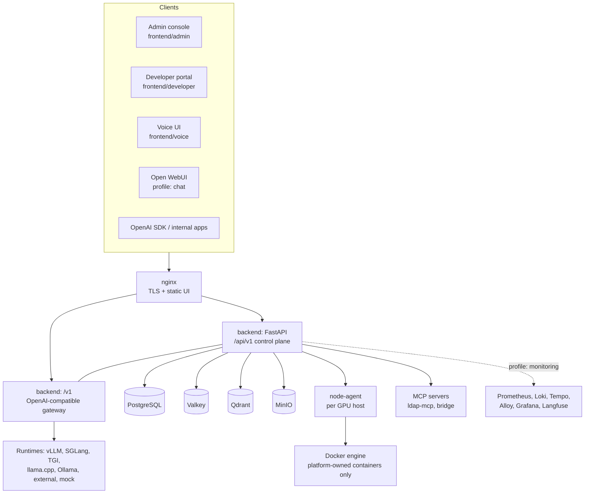

# Current state (Phase 0 audit)

Audit of the repository at commit `0eedc13` against
[`docs/roadmap/Private-AI-Platform-Expansion-Plan.md`](../roadmap/Private-AI-Platform-Expansion-Plan.md)
(the "expansion plan"). Every *Existing* claim below names the file that implements it.
"Existing" means present in code, not necessarily verified by a test run on this audit
(see [§8 Baseline](#8-baseline-test-results)).

Status vocabulary, per expansion plan §3:

- **Existing**: implemented and wired into the API/UI.
- **Partial**: some of the plan's requirement exists; the gap is named.
- **Planned**: absent; in the expansion plan.
- **External**: delegated to a third-party component used as-is.

---

## 1. Architecture and service responsibilities



The backend is a **modular monolith** (`backend/app/`), which is what the expansion plan's
§9 recommends. It is layered `api → services → repositories → models`, and the layering
is enforced by contracts run in `make check` (see `docs/architecture.md` §4).

| Service (compose) | Profile | Responsibility |
|---|---|---|
| `backend` | core | Control-plane REST API, OpenAI gateway, agent runtime, APScheduler workers |
| `postgres` | core | Relational metadata, audit, usage, runs |
| `valkey` | core | Rate-limit counters, cache (Redis-compatible; licensing choice) |
| `qdrant` | core | Vectors for knowledge bases and memory |
| `minio` | core | Original document and model-file objects |
| `node-agent` | core | GPU telemetry and container control on a GPU host |
| `nginx` | core | TLS termination, static UIs, proxying |
| `mock-vllm`, `oidc-fixture` | development | GPU-free inference and IdP fixtures |
| `llamacpp` | local-llm | CPU inference of GGUF models |
| `ldap-mcp` | agents | Directory lookup MCP server |
| `open-webui` | chat | End-user chat, consumes only the gateway |
| `prometheus`, `loki`, `tempo`, `alloy`, `grafana`, `langfuse` | monitoring | Metrics, logs, traces, LLM traces |

Source: `docker-compose.yml`. Plus `docker-compose.mcp.yml`, `docker-compose.dev.yml` and
`docker-compose.prod.yml`.

---

## 2. API inventory

Routers are assembled in `backend/app/api/v1/router.py` under `/api/v1`. The gateway is
mounted separately at `/v1` (`backend/app/main.py`). There are about 135 route handlers.

| Router file | Routes | Covers |
|---|---|---|
| `api/v1/auth.py` | 7 | login, refresh, logout, me, providers, OIDC authorize/callback |
| `api/v1/users.py` | 10 | users, role assignment, roles, permissions |
| `api/v1/infrastructure.py` | 28 | nodes, enrollment tokens, node bundle download, GPUs, metrics, containers, allocations |
| `api/v1/models.py` | 27 | model registry, Ollama import, deploy/stop, deployments, aliases, API clients, API keys (create/rotate/revoke), usage |
| `api/v1/dashboard.py` | 1 | operator dashboard aggregate |
| `api/v1/agents.py` | 28 | tools, MCP servers, skills, agents, execute, runs, run events, cancel, approve |
| `api/v1/knowledge.py` | 14 | knowledge bases, documents, search preview, memory |
| `api/v1/audit.py` | 2 | audit log query, action list |
| `api/v1/monitoring.py` | 2 | observability overview, trace lookup |
| `api/v1/voice.py` | 5 | voice sessions and configuration |
| `api/v1/health.py` | 4 | liveness, readiness, version |
| `api/v1/gateway.py` (`/v1`) | 6 | `models`, `chat/completions`, `completions`, `embeddings`, `audio/transcriptions`, `audio/speech` |
| `api/metrics.py` | 1 | Prometheus scrape (unauthenticated, not proxied) |
| `api/voice_ws.py` | WS | voice conversation WebSocket |

The plan's route groups that have **no router today**: `/teams`, `/backends`,
`/workflows`, `/approvals` (approval lives under `/runs/{id}/approve`), `/alerts`,
`/backups`, `/updates` and `/diagnostics`.

---

## 3. Database inventory

ORM models are in `backend/app/models/`. The schema history is 14 Alembic migrations in
`backend/alembic/versions/`.

| Area | Tables |
|---|---|
| Identity | `users`, `roles`, `permissions` (+ association tables) |
| Audit | `audit_logs` |
| System | `system_settings` |
| Infrastructure | `nodes`, `node_enrollments`, `gpus`, `gpu_metrics`, `gpu_processes`, `gpu_health_events`, `gpu_allocations`, `containers` |
| Models and gateway | `models`, `model_files`, `model_deployments`, `model_aliases`, `api_clients`, `api_keys`, `usage_records` |
| Agents | `tools`, `mcp_servers`, `skills`, `agents`, `agent_versions`, `agent_tools`, `agent_skills`, `agent_runs`, `agent_run_events`, `tool_executions` |
| Knowledge | `embedding_models`, `knowledge_bases`, `documents`, `document_chunks`, `conversations`, `conversation_messages`, `memory_entries` |
| Voice | `voice_sessions`, `voice_messages`, `voice_events` |

Notable facts:

- **Tenant scope exists only in the knowledge tables.** `knowledge_bases`,
  `conversations` and `memory_entries` carry `tenant_id` (default `"default"`), and
  `services/retrieval.py` drops cross-tenant bases. Users, models, agents, keys and usage
  have no tenant or team column.
- **Model status** is about file availability (`REGISTERED`, `AVAILABLE`, `UNAVAILABLE`,
  `DISABLED`). The plan's governance status (approved / experimental / deprecated /
  blocked) does not exist.
- **Deployment states** are `REQUESTED → VALIDATING → SCHEDULING → CREATING → STARTING
  → HEALTH_CHECK → RUNNING`, with `FAILED`, `STOPPING` and `STOPPED`. There are no
  configuration revisions or rollback.
- **Agent runs** have `WAITING_FOR_APPROVAL`, and approval state is a durable row
  (`PENDING`, `APPROVED`, `REJECTED`, `EXPIRED`).

---

## 4. UI page inventory

There are three no-build-step UIs (vanilla JS, vendored Bootstrap and Chart.js):

| UI | Pages |
|---|---|
| `frontend/admin` | Dashboard, Chat, Nodes, GPUs, Containers, Models, Deployments, Endpoints, Agents, Skills, Tools, Approvals, Knowledge, Memory, Voice, Users, Audit (17) |
| `frontend/developer` | Developer portal: API keys and usage for key holders |
| `frontend/voice` | Voice assistant (Three.js visuals) |
| Open WebUI | End-user chat (external) |

Plan pages **not present**: Backends, Deployment Wizard (deploy is a form, not a
validated wizard), API Gateway policies, Services (compose health), Retrieval Playground
(a search preview exists inside Knowledge), MCP Servers (listed under Tools), Workflow
Builder, Workflow Runs, Usage (admin), Alerts, Roles & Permissions editor, Settings,
Backup & Restore, Offline Updates and Diagnostics.

---

## 5. Feature status against the expansion plan

Full per-feature detail is in [`docs/roadmap/feature-matrix.md`](../roadmap/feature-matrix.md).

| Plan § | Area | Status | Main gap |
|---|---|---|---|
| 5.1 | Unified dashboard | Partial | No time-range filters, alerts, ingestion failures or service dependency view |
| 5.2 | Inference backend management | Partial | Runtimes are per-deployment; no `inference_backends` entity, test-connection or capability record (Ollama import exists) |
| 5.3 | Model registry | Partial | Has files, sha256, quantization, context length. Missing license, approval status, version grouping, team access |
| 5.4 | Deployment lifecycle | Partial | State machine and GPU scheduler exist. No revisions, rollback, wizard validation or production approval |
| 5.5 | OpenAI gateway | Partial | Streaming, aliases, keys, usage and per-key RPM exist. No token quotas, circuit breaker, fallback policy or per-model concurrency limit |
| 5.6 | GPU / infra monitoring | Existing | Host CPU/RAM/disk is less complete than GPU telemetry |
| 5.7 | Knowledge / RAG | Partial | Ingestion, OCR, chunking, tenant-scoped retrieval and citations exist. No reranking stage, RAG evaluation sets, document versioning or per-document ACL |
| 5.8 | MCP / tools | Existing | Risk level, required permission and executions are present. Network egress restriction per tool is unverified |
| 5.9 | Agents | Existing | Versioned, budgets, approvals, cancel. No explicit global kill switch |
| 5.10 | Workflow builder | Planned | Nothing exists |
| 5.11 | Chat / playground | Partial | Chat (admin + Open WebUI), developer portal. No request-builder playground |
| 5.12 | Identity / RBAC / teams | Partial | Local, OIDC and LDAP sign-in (`services/auth_providers.py`) and RBAC exist. No teams, tenants outside knowledge, or the plan's 8 built-in roles |
| 5.13 | Audit / governance | Partial | Audit log exists. No retention/redaction policy UI or exportable reports |
| 5.14 | Usage and quotas | Partial | Usage records and per-key RPM. No token or budget quotas |
| 5.15 | Notifications / alerts | Partial | Prometheus rules only (`docker/prometheus/rules/platform.yml`). No in-app alerts |
| 5.16 | Offline install / upgrade / backup | Existing (CLI) | `offline/*.sh`, `scripts/build_bundle.py`, `scripts/backup.py`. Manifest carries SHA-256 checksums (`scripts/build_bundle.py`, verified in `offline/lib.sh`) but is **not signed**, and has no SBOM. No UI |
| 5.17 | Security hardening | Existing (mostly) | See §6 |

---

## 6. Security and operations gaps

Strengths already in place (see `docs/security.md`):

- API keys hashed; node tokens and secrets Fernet-encrypted (`core/security.py`).
- Generated secrets, no default production password (`scripts/gen_secrets.py`, bootstrap admin from `.env`).
- Node agent refuses containers it did not create; there is no Docker socket in the browser path.
- `COMMAND`/`PYTHON` tool types are disabled; tools need an explicit permission and are re-checked against the *invoking user's* permissions.
- API keys stored as SHA-256 hashes, plaintext shown once (`services/api_keys.py`).
- Failed logins counted per user (`services/auth.py`); login CSRF handled on the OIDC callback.
- Node enrollment: per-token attempt cap, per-IP rate limit, and agent port pinned to an allowlist as an SSRF control (`config/settings.py`, enrollment section).
- Air-gap check (`scripts/check_airgap.py`) and pinned requirements (`requirements*.txt` from `.in`).

Gaps against plan §5.17 and the threat model:

1. **No team/tenant isolation outside knowledge.** Any user with a permission sees all models, agents, keys and usage.
2. **No threat-model document** with mitigation, residual risk and test per threat (plan §5.17).
3. **SSRF defenses** exist for node enrollment (port allowlist) but are not a single policy covering the Ollama endpoint, external providers and MCP endpoints; this needs a review.
4. **Failed-login lockout** is counted but not documented as enforced; check `services/auth.py` before claiming lockout.
5. **No SBOM** generation in `scripts/build_bundle.py` (licenses are carried; SBOM is not).
6. **Backup/restore and upgrade are CLI-only**, so they are not audited through the API.
7. **No in-app alerting**, so operational failures surface only when monitoring is enabled.

---

## 7. Mapping to the target architecture and compatibility risks

The mapping is detailed in [`target-architecture.md`](target-architecture.md). Risks for
the expansion:

| Risk | Why | Mitigation |
|---|---|---|
| Adding `tenant_id`/`team_id` to existing tables | Every protected query must filter, or isolation is false. Existing rows need a default | Additive migration with `default='default'` like knowledge already does; scope filter in the repository layer; authorization tests per route |
| Introducing `inference_backends` | Deployments currently carry runtime + endpoint inline | Make backend optional on deployments first, backfill one backend per distinct external endpoint, keep inline fields readable |
| Plan names vs. existing names (`audit_events` vs `audit_logs`, `gateway_api_keys` vs `api_keys`) | Renames break migrations, backup and docs | Keep existing names (plan §3: "do not rewrite a working module just to match suggested naming") |
| Compose profile names differ (`monitoring` vs `observability`, no `rag`/`inference`) | Scripts and docs reference current names | Add plan names as *aliases* only if needed; do not rename |
| Gates drop all tables | `alembic downgrade base` in gate scripts | Never run gates against real data; document this in every phase report |
| Frontend is vanilla JS with no build step | About 12 new pages will grow `admin.js` | Split `admin.js` into per-page modules (still no build step) before adding pages |
| Doc drift | `docs/architecture.md` §1–3 still name LangGraph as the agent runtime; the README states it is native | Fix in Phase 1 docs pass |

---

## 8. Baseline test results

There is **no baseline recorded on this audit machine.** It has no `make` or `docker`,
and Python 3.10 where the backend requires 3.12. The plan's Phase 0 acceptance item
"baseline tests recorded" is still **open**. Record it on a machine with Docker:

```bash
make up && make check    # lint, mypy, layering, ~500 test functions across 4 services
make gate                # Phase 0 gate. WARNING: gates drop every table
```

Record the pass/fail counts here when that has been done.
