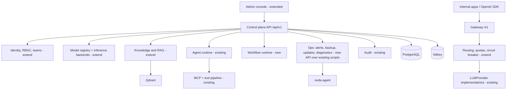

# Target architecture

The expansion plan's target (§4) mapped onto **existing** modules. The rule, per plan §3
and §18: extend what works, keep existing names, add only what is missing. The current
state is in [`current-state.md`](current-state.md).

## Shape

The backend stays a **modular monolith**. The gateway stays inside the backend process,
mounted at `/v1`. Splitting it into its own container is deferred until there is a measured
scaling or reliability need (plan §9).

## Layer-by-layer mapping

| Plan layer | Existing module(s) | Change |
|---|---|---|
| Web UI | `frontend/admin` (vanilla JS) | Keep. Split `admin.js` into per-page modules, then add missing pages |
| Control plane API | `backend/app/api/v1/*` | Add routers: `backends`, `teams`, `alerts`, `workflows`, `approvals` (read view over run approvals), `backups`, `updates`, `diagnostics` |
| Model gateway | `api/v1/gateway.py`, `services/gateway.py` | Add token/budget quotas, per-model concurrency, circuit breaker, explicit fallback policy on aliases |
| Model adapters | `core/interfaces/llm.py`, `services/llm_provider.py`, `services/model_registry.py` | Add first-class `inference_backends` with `test_connection`, `list_models` and declared capabilities; existing providers become adapters behind it |
| RAG service | `services/knowledge.py`, `retrieval.py`, `chunking.py`, `document_parsers.py`, `workers/ingestion.py` | Add reranking stage (RERANKER model type already exists), document versioning, evaluation sets |
| Agent runtime | `services/agent_runtime.py`, `agent_runs.py`, `tool_pipeline.py` | Add global kill switch; otherwise keep |
| MCP / tool gateway | `models/agents.py` (`mcp_servers`, `tools`), `services/tool_executors.py` | Unified outbound URL (SSRF) policy shared with backends |
| Workflow runtime | none | New: persisted deterministic engine on Postgres + APScheduler (`workers/scheduler.py`); no external engine |
| Data layer | Postgres, Valkey, Qdrant, MinIO | Additive migrations only |
| Observability | `core/metrics.py`, `core/tracing.py`, monitoring profile | Add in-app `alerts` table fed by health checks and workers |
| Operations | `offline/*.sh`, `scripts/build_bundle.py`, `scripts/backup.py` | Expose backup, restore, version and diagnostics through audited API; add manifest signing and SBOM |

## Cross-cutting decisions

1. **Scope model.** Add `tenant_id` (default `"default"`) and nullable `team_id` to
   protected resources, following the pattern `models/knowledge.py` already uses. Add
   `teams` and `team_memberships`. Scope filters belong in `repositories/`, the only layer
   that writes SQL.
2. **Naming.** Keep `audit_logs`, `api_keys`, `model_deployments` and so on. The plan's
   table names are logical, not required.
3. **Compose profiles.** Keep `core`, `monitoring`, `agents`, `chat`, `local-llm` and
   `development`. Document how they map to the plan's `core`, `observability`, `agents`,
   `inference` and `full` instead of renaming.
4. **Frontend.** Keep the vanilla JS, no-build-step approach. It fits the air-gap
   constraint (nothing to bundle). Revisit React only with a written decision record.
5. **Replaceability.** New subsystems get an ABC in `core/interfaces/` first, the same
   discipline as the existing seams.
